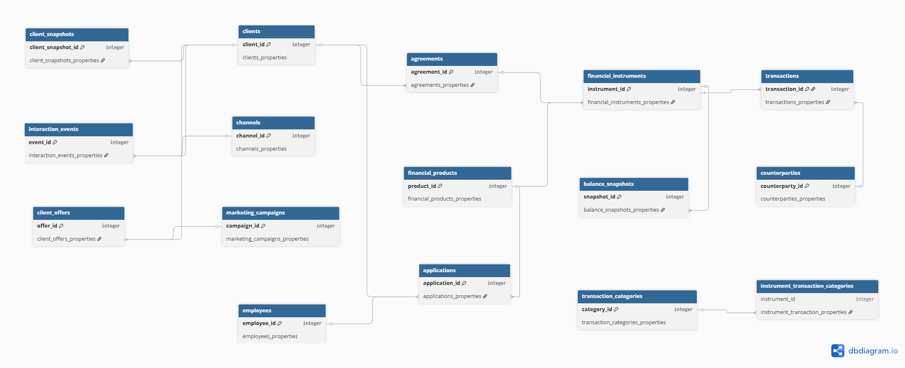
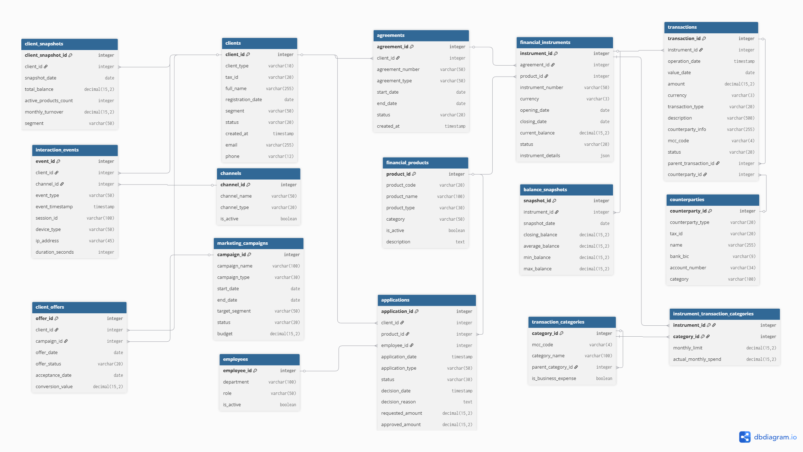

# sql-database-design

Этот репозиторий представляет собой пет-проект по проектированию, оптимизации и развертыванию высоконагруженной реляционной базы данных, обслуживающей ключевые банковские процессы (транзакции, счета, клиенты).

---

## Оглавление
- [Цель проекта](#-цель-проекта)
- [Архитектура и схема данных](#-архитектура-и-схема-данных)
- [Ключевые особенности реализации](#-ключевые-особенности-реализации)
- [Индексация и производительность](#-индексация-и-производительность)
- [Генерация данных (DML Seed)](#-генерация-данных-dml-seed)
- [Запросы к БД](#-запросы-к-бд)

---

## Цель проекта
Разработать отказоустойчивую и нормализованную базу данных для банковской экосистемы, покрывающую следующие сферы:
1. **Клиентский профиль:** управление персональными данными, сегментация клиентов (`retail`, `vip`, `sme`).
2. **Продуктовая фабрика и учет:** договоры, счета, дебетовые/кредитные карты, кредиты и депозиты.
3. **Процессинг транзакций:** учет операций, связка с внешними контрагентами и категоризация расходов по кодам MCC.
4. **Маркетинг и лояльность:** отслеживание омниканальных рекламных кампаний, персональных предложений и цифровых событий (session log, IP, устройства).
5. **Аналитические витрины:** снапшоты балансов и профилей клиентов для построения быстрой управленческой отчетности.

---

## Архитектура и схемы данных

База данных спроектирована с соблюдением требований 3-й нормальной формы (3NF).

### Концептуальная модель

### Логическая модель (ER-диаграмма)

### Основные сущности:
* `clients` & `agreements` — договоры и профили клиентов.
* `financial_products` & `financial_instruments` — продуктовая линейка и конкретные выпущенные карты/счета клиентов.
* `transactions` & `transaction_categories` — транзакционный поток с привязкой к MCC-кодам и контрагентам.
* `client_offers` & `interaction_events` — воронка маркетинга и история цифровых взаимодействий.
* `balance_snapshots` & `client_snapshots` — исторические срезы для аналитики и отчетности без перегрузки транзакционных таблиц.

---

## ⚙️ Ключевые особенности реализации

* **Целостность данных на уровне СУБД:** Использование декларативных ограничений `CHECK` для валидации статусов, дат (например, дата закрытия строго позже открытия) и сумм операций.
* **Каскадное управление связями:** Реализованы политики `ON DELETE CASCADE` для подчиненных сущностей (договоры/инструменты) и `ON DELETE RESTRICT` для критически важных сущностей (транзакции, продукты).
* **Гибкость атрибутов (NoSQL в SQL):** Для хранения кастомизируемых параметров продуктов (процентные ставки, овердрафты, признаки автоплатежа) использован тип данных `JSON/JSONB`.

---

## Индексация

Для улучшения производительности БД при выполнении операций `JOIN` и фильтрации настроены индексы на ключевые внешние ключи:
* `agreements(client_id)`
* `financial_instruments(agreement_id)`
* `transactions(instrument_id)`
* `applications(client_id)`
* `client_snapshots(client_id)`
* `balance_snapshots(instrument_id)`

---

## 🎲 Генерация данных (DML Seed)

Написан автономный SQL-генератор синтетических данных без использования внешних библиотек:
* Применение генераторов последовательностей `generate_series()` и функций рандомизации.
* Математическое моделирование реалистичных распределений: логарифмические зависимости длительности сессий, корреляция сумм списаний/зачислений.
* Консистентность бизнес-логики:
  * Статусы заявок `applications` строго соответствуют логике выставления сумм и дат принятия решений.
  * Лимиты категорий назначаются только платежным инструментам (`card`, `account`).
  * MCC-коды операций соответствуют существующему справочнику категорий.

---

## Запросы к БД

В процессе..

